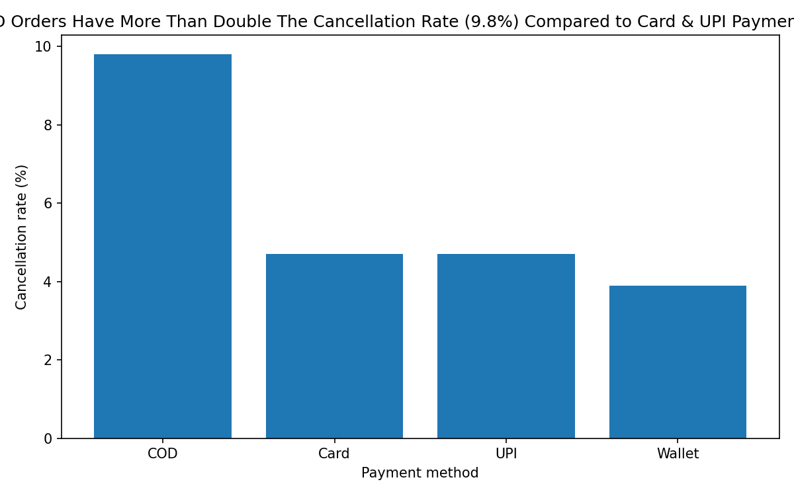
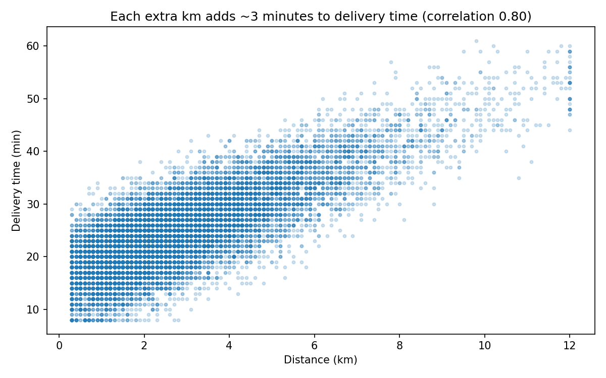
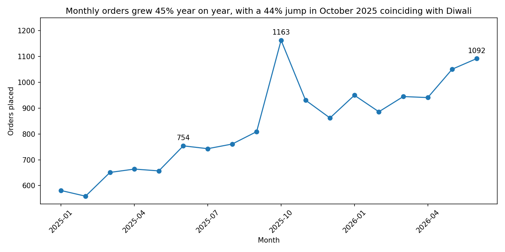

# Cash orders cancel twice as often, and three cities bring in 73% of revenue

> **Self-directed project on a synthetic dataset.** Dabba Dash is a fictional company. Every row of data was generated by a script (see `generator/`). Not affiliated with any real company.

## Business problem

Dabba Dash is a made-up 10-minute-style food delivery company. It operates in six Indian cities. The data covers 15,000 orders from January 2025 to June 2026.

A growth team would ask four simple questions:

1. Where does our revenue come from?
2. How fast are orders growing, and when do they spike?
3. Where do we lose orders to cancellations?
4. What makes deliveries slow?

Metrics used: **revenue** (basket value of delivered orders), **orders placed**, **cancellation rate**, and **delivery time** in minutes.

## Executive summary

- Cash on delivery (COD) orders are cancelled at **9.8%**. That is more than double the rate for Card and UPI (**4.7%**).
- Each extra kilometre adds about **3.2 minutes** to delivery time. About **1 in 6** orders travels more than 5 km.
- Orders in June 2026 were **45% higher** than in June 2025. October 2025 jumped **44%**, in the Diwali month.
- Revenue is concentrated: Mumbai brings in **31%**, and the top 3 cities (Mumbai, Bengaluru, Delhi) bring in **73%**.

## Insights

### 1. Cash orders are the weakest link: 9.8% are cancelled
COD orders have a 9.8% cancellation rate. Card and UPI orders sit at 4.7%, and Wallet at 3.9%. A cancelled order brings in no money, but the restaurant and the rider may already have started work. Every COD order moved to a digital payment lowers that risk.

*COD cancels at more than double the rate of Card and UPI.*

### 2. Distance, not luck, drives slow deliveries
Delivery time and distance move together strongly (correlation 0.80). Each extra kilometre adds about 3.2 minutes. About 15.6% of orders travel more than 5 km, so these slow trips are common, not rare.

*Longer trips take steadily longer: about 3 minutes per extra km.*

### 3. Orders keep growing, and Diwali caused a one-month spike
Monthly orders rose from 754 in June 2025 to 1,092 in June 2026. October 2025 reached 1,163 orders, up 44% on September. It fell about 20% in November. But November (931) and December (862) stayed above the pre-Diwali level (809 in September). So the festival spike faded, while the higher base stayed.

*Growth is steady, with one sharp festive peak in October 2025.*

### A mistake I caught in my own work
After removing duplicates, I re-ran the cell that loads the file. This quietly loaded the raw data again and undid my cleaning. I noticed because the average delivery time (25.665) did not match the number I expected (25.655). I fixed it with Restart & Run All, and I now check key numbers after every cleaning step.

## Recommendations

| Action | Owner | Expected impact | Metric to track |
|---|---|---|---|
| Run a limited UPI/Card promo and check whether COD's share of orders and its cancellations fall | Growth team | Fewer cancelled orders if COD customers switch (my expectation, not measured) | COD share of orders; cancellation rate by payment method |
| Sign up restaurants closer to customers in areas where trips are long, and test whether delivery time falls | Supply / city operations | Shorter trips cut about 3 minutes per km saved (my expectation, not measured). About 15.6% of orders travel over 5 km | Average distance; average delivery time |

## Caveats

- **The data is synthetic.** Patterns here come from a script I can read, so this shows my method, not a real market.
- **Association is not proof.** COD orders cancel more, but I have not shown that COD *causes* it. That is why the first recommendation is a pilot.
- **I made judgement calls.** I blanked 49 impossible delivery times (clock errors) and kept the orders, so revenue stays whole. The average moved from 27.2 to 25.7 minutes. Blanks in customer type (317) and payment method (227) were kept, so they drop out of any grouping by those columns.
- **Short history.** The 45% growth compares one month with the same month a year earlier. The data covers only 18 months and one Diwali.

## Appendix

**Files**

| File | What it is |
|---|---|
| `Day75_EDA.ipynb` | The full analysis notebook |
| `dabba_dash_orders.csv` | The synthetic dataset (15,180 rows, 14 columns) |
| `DATA_DICTIONARY.md` | What each column means |
| `generator/generate_orders.py` | The script that created the data (seed 75) |
| `*.png` | The four charts above |

**Tools:** Python, pandas, matplotlib, Jupyter Notebook.

**Cleaning steps (in order)**

1. City names: 11 spellings standardised to 6 cities.
2. Duplicates: 180 exact copies removed (15,180 to 15,000 rows).
3. Impossible delivery times: 49 delivered orders over 180 minutes set to blank.
4. Blank delivery time and rating: left blank on purpose. Cancelled orders were never delivered, and many customers do not rate.
5. Blank customer type and payment method: left blank, about 2% and 1.5% of rows.
6. Dates converted from DD-MM-YYYY text to real dates, and a month column added.

**Method:** Revenue counts delivered orders only. Cancellation rate is the share of orders with status "Cancelled". The 3.2 minutes per km comes from a best-fit straight line through delivered orders with a valid delivery time (14,119 orders).

**To run it:** open `Day75_EDA.ipynb` in Jupyter from this folder and choose Kernel, then Restart & Run All.
